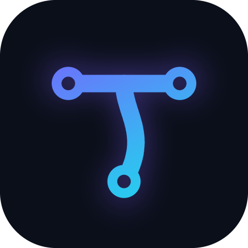

<div align="center">



# Theyso

**Drive Claude Code or OpenCode on your PC from your phone — with any model, no relay, no subscription lock-in.**

[Español](README.es.md) · [Architecture](docs/ARCHITECTURE.md) · [Security](SECURITY.md) · [Protocol](docs/PROTOCOL.md) · [Roadmap](docs/ROADMAP.md)

   

<video src="https://github.com/s7ex-j/theyso/raw/main/docs/brand/demo.mp4" poster="https://github.com/s7ex-j/theyso/raw/main/docs/brand/poster.jpg" controls muted width="760"></video>

<sub>▶ 48-second overview — if the player doesn't load, <a href="https://github.com/s7ex-j/theyso/raw/main/docs/brand/demo.mp4">open the clip</a>.</sub>

</div>

> Your phone, your PC, a direct line between them — over your own private network,
> and never through anyone else's server.

## Why another one?

There are good ways to use Claude Code from a phone already: Anthropic's official **Remote Control**, and community apps such as **Happy**, **Termopus** or **Claude Remote**. Theyso exists for a specific gap:

| | Official Remote Control | Relay-based apps | **Theyso** |
|---|---|---|---|
| Works with a claude.ai Pro/Max login | ✅ | ✅ | ✅ |
| Works with API keys / `ANTHROPIC_BASE_URL` routers (9Router, LiteLLM, OpenRouter, DeepSeek…) | ❌ | depends | ✅ first-class, per-session **profiles** |
| OpenCode support | ❌ | rarely | ✅ (experimental) |
| Traffic path | via Anthropic | via the project's relay | **phone ↔ PC only**, over your Tailscale tailnet |
| Cost analytics that understand free / routed models | ❌ | ❌ | ✅ spend vs. list-price equivalent, per model |
| Policy engine (always-deny, high-risk + biometrics) | basic | basic | ✅ |

## How it works

```
┌──────────────┐  WireGuard (Tailscale)   ┌──────────────────────────┐  Agent SDK / HTTP  ┌────────────────────────┐
│ Phone        │  + Ed25519 mutual auth   │ theyso serve (your PC)   │ ─────────────────▶ │ Claude Code / OpenCode │
│ Flutter app  │ ◀──────────────────────▶ │ policy · redaction · log │                    │ any model / router     │
└──────────────┘    JSON over WebSocket   └──────────────────────────┘                    └────────────────────────┘
```

* **No terminal scraping.** Claude Code is driven through the official Agent SDK (structured messages, permission callbacks); OpenCode through its headless HTTP server.
* **QR pairing with a 6-digit check**, like pairing Bluetooth headphones. No passwords, no bearer tokens.
* **Every tool call passes a policy**: `rm -rf ~` is refused before it reaches you; `git push --force` needs your fingerprint.
* **Replay on reconnect**: lose signal in the elevator and you get exactly the events you missed.
* **Live replies**: text streams in while the agent writes it (throttled, and never half a word — so never half a secret).
* **Offline dictation**: speak your prompt; it is transcribed on the phone and only fills the box — you press send.
* **Private screen**: no screenshots, blank thumbnail in recent apps, biometric lock on open.
* **Keeps your PC awake only while an agent session is open and the charger is connected** — no power-settings surgery.
* **Light**: the bridge idles at ~55 MB of RAM; the app has no background services.
* **Audited**: Bandit, Semgrep, detect-secrets and pip-audit run clean; 16 active attack tests ship in CI ([AUDIT.md](docs/AUDIT.md)).

## Quick start

**PC** (Linux / macOS / Windows, Python 3.11+, [Tailscale](https://tailscale.com) installed and logged in):

```bash
pipx install "git+https://github.com/s7ex-j/theyso#subdirectory=server"
theyso init                # config.toml + server key + secrets.env (for API keys)
# edit [workspaces].allowed and your [profiles.*]
theyso doctor              # checks Tailscale, agents, file permissions
theyso serve               # listens ONLY on your Tailscale IP
theyso pair                # (another terminal) shows the QR
theyso service install     # optional: start automatically when you log in
```

**Phone:** install Tailscale with the same account, build the app (`cd app && python tool/setup.py`, see [app/README.md](app/README.md)) or grab the APK from the latest GitHub Actions run, tap **Vincular PC**, scan, compare the 6-digit code, approve on the PC.

## Profiles: any model

```toml
[profiles.router]                 # Claude Code through a local router
agent = "claude-code"
model = "your-router-model-id"
[profiles.router.env]
ANTHROPIC_BASE_URL   = "http://127.0.0.1:20128"
ANTHROPIC_AUTH_TOKEN = "env:ROUTER_API_KEY"   # secrets come from the environment, never the file

[profiles.opencode]
agent = "opencode"                 # uses whatever providers OpenCode is configured with
```

From the phone you pick the profile when you open a session, and can switch model mid-session. See [docs/PROVIDERS.md](docs/PROVIDERS.md).

## Security in one screen

* Binds only to loopback or Tailscale addresses; `0.0.0.0` requires an explicit opt-in.
* Pairing: one-time 256-bit secret in a 2-minute QR, HMAC proof bound to the phone's key, human-verified SAS code, single use, burned after 5 bad tries.
* Every connection: mutual Ed25519 challenge-response with fresh nonces; the phone pins the PC's key.
* `bypassPermissions` is rejected by config validation. Unanswered permission requests are **denied** after a timeout.
* Secrets (API keys, tokens, private keys, `.env` values) are masked before leaving the PC.
* Protected paths (`~/.ssh`, `~/.aws`, `.env`, Theyso's own config) are denied for every tool.
* Panic button on the phone and `theyso panic` on the PC; `theyso revoke` cuts a device's live connection immediately.
* Append-only audit log (prompts stored as hashes by default).

Full details: [SECURITY.md](SECURITY.md) and [docs/THREAT_MODEL.md](docs/THREAT_MODEL.md).

## Repository layout

```
server/   Python bridge: FastAPI + WebSockets, agent adapters, security, metrics, CLI, tests
app/      Flutter app: pairing, chat, permission cards, diffs, usage dashboard
docs/     architecture, protocol, pairing, threat model, providers, roadmap
```

## A note on third-party routers

Theyso passes the environment variables **you** configure to the agent; it does not ship account rotation, token sharing or any mechanism to get around a provider's limits. Some routers offer features (e.g. reusing subscription OAuth tokens or rotating accounts) that may violate the terms of the underlying provider — that choice and its risk are yours.

## Status

Alpha. The server has a test suite covering pairing, the handshake, the policy, redaction and an end-to-end session; the app shares cryptographic test vectors with the server. Expect breaking protocol changes before 1.0.

## License

MIT © Jharol André Vilca Ramos
