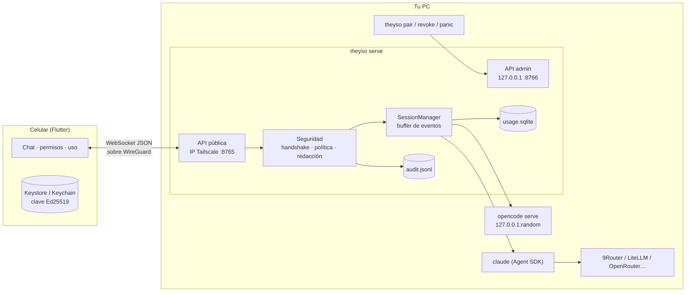
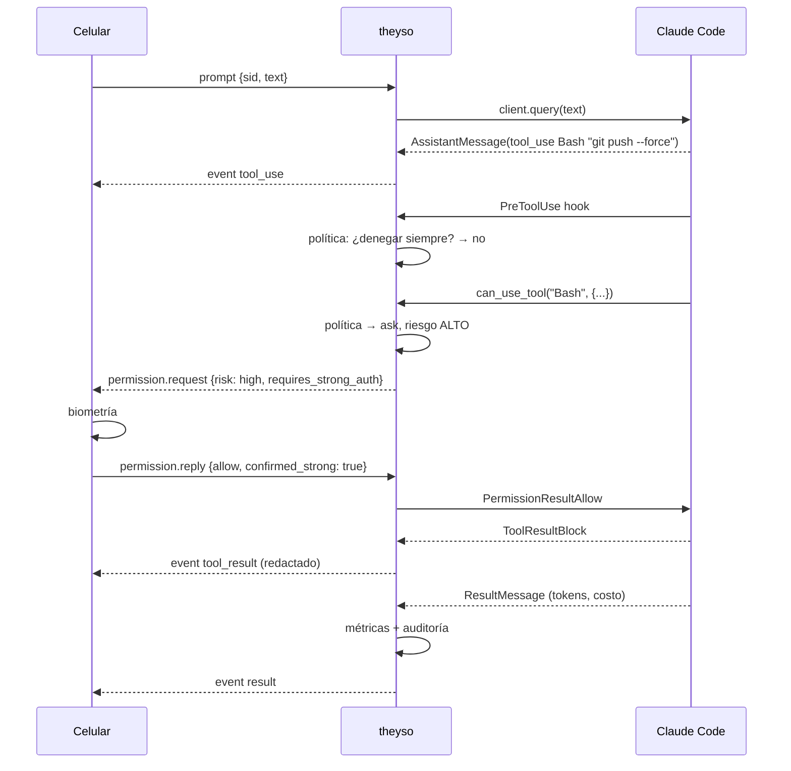

# Arquitectura

## Vista general

## Decisiones clave

### 1. Agent SDK en lugar de pseudoterminal

La idea inicial era controlar la TUI de Claude Code con `node-pty`/`pexpect` y "limpiar"
los caracteres de control. Se descartó porque:

- la TUI se redibuja (spinners, cajas, menús) y el parseo se rompe con cada versión;
- los diálogos de permiso son texto, no datos: no hay forma robusta de saber qué herramienta y qué argumentos se están pidiendo;
- el Agent SDK ofrece exactamente lo que necesitamos: mensajes tipados, un callback `can_use_tool`, hooks `PreToolUse`, `interrupt()`, `set_model()`, reanudar sesiones y checkpoints de archivos.

El SDK lanza el mismo binario `claude`, así que `ANTHROPIC_BASE_URL` y demás variables de entorno funcionan igual que en la terminal.

### 2. Adaptadores por agente

`agents/base.py` define una interfaz mínima (`start`, `send`, `interrupt`, `set_model`, `close`) y un
formato de eventos normalizado (`text`, `thinking`, `tool_use`, `tool_result`, `status`, `result`, `notice`, `error`).
La app no sabe qué agente hay detrás. Añadir Codex CLI o Gemini CLI = un archivo nuevo.

### 3. Sin relay, Tailscale como transporte

Un relay (como usan Happy o Termopus) resuelve NAT pero introduce un tercero. Tailscale resuelve NAT con
conexiones directas WireGuard entre tus propios dispositivos, gratis para uso personal.
Theyso no confía *solo* en Tailscale: añade autenticación mutua a nivel de aplicación.

### 4. Dos APIs en el mismo proceso

| | Pública | Admin |
|---|---|---|
| Escucha en | IP de Tailscale | 127.0.0.1 |
| Autenticación | firma Ed25519 del dispositivo | token local (archivo 0600, rotado al arrancar) |
| Para | el celular | el CLI `theyso` en la PC |
| Puede aprobar vinculaciones | **no** | sí |

### 5. Eventos numerados y reproducción

Cada evento de una sesión lleva `seq`. El servidor guarda los últimos N (por defecto 1000) en un buffer
circular. Al reconectar, la app envía `session.attach {after_seq}` y recibe solo lo que perdió.
Las solicitudes de permiso pendientes se reenvían siempre.

### 6. Costos honestos con routers

Claude Code calcula `total_cost_usd` con los precios de lista de Anthropic *según el nombre del modelo*,
aunque la petición haya ido a un modelo gratis vía router. Theyso etiqueta cada turno con una
`cost_basis` (`reported`, `profile_price`, `list_equivalent`) para no mezclar gasto real con "ahorro".

## Flujo de un turno con permiso

## Persistencia en la PC (`~/.config/theyso/`, 0700)

| Archivo | Contenido | Sensible |
|---|---|---|
| `config.toml` | configuración (sin secretos) | bajo |
| `server_key.pem` | identidad Ed25519 del servidor | **alto** |
| `devices.json` | claves **públicas** de celulares vinculados | medio |
| `admin.token` | token de la API local (existe solo mientras corre) | alto |
| `audit.jsonl` | eventos de seguridad | medio |
| `usage.sqlite` | métricas de uso | bajo |
