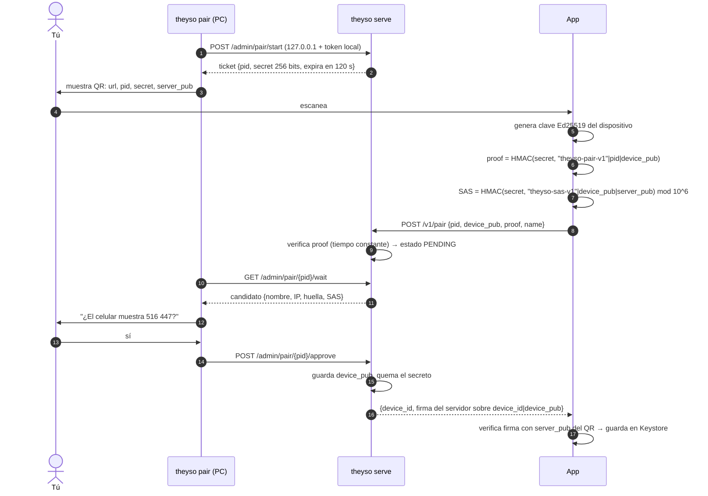

# Vinculación por QR



## Por qué cada pieza

| Pieza | Sin ella… |
|---|---|
| Secreto en el QR (no en la red) | cualquiera en el tailnet podría pedir vincularse |
| `proof` HMAC en vez de enviar el secreto | el secreto viajaría y podría reutilizarse |
| `proof` incluye `device_pub` | un intermediario podría cambiar la clave del celular por la suya |
| SAS de 6 dígitos comparado por una persona | quien fotografió el QR podría adelantarse a tu celular sin que lo notes |
| Aprobación en la PC, no en el celular | el celular no puede autoaprobarse |
| Expira en 2 min, uso único, 5 intentos | un QR viejo en una foto o captura no sirve |
| Un solo ticket vivo a la vez | abrir un QR nuevo invalida el anterior |
| Firma del servidor en la respuesta | el celular no guardaría una PC falsa |
| `server_pub` en el QR (pinning) | en conexiones futuras otra máquina podría hacerse pasar por tu PC |

## Formato del QR

```
theyso://pair?d=<b64u(JSON)>
JSON = {"v":1,"url":"ws://100.x.y.z:8765","pid":"…","sec":"<b64u 32 bytes>",
        "spk":"<b64u 32 bytes>","name":"mi-pc","exp":1761500120}
```

Se usa un esquema propio (`theyso://`) para que la cámara del sistema no intente abrirlo en el navegador.

## Vectores de prueba

`server/tests` (Python) y `app/test/crypto_test.dart` (Dart) comparten valores esperados para la
prueba HMAC, el SAS, la huella y la transcripción del handshake. Si uno cambia, CI falla en ambos lados.
