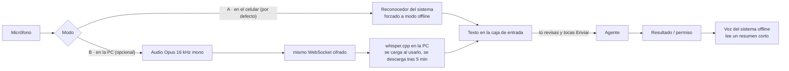

# Control por voz

> **Estado:** el modo A (dictado en el celular) está implementado en v0.1.1. El modo B y la
> lectura en voz alta son la propuesta para v0.2.

Objetivo: hablarle al agente desde el celular **sin que el audio salga de tus dispositivos** y sin
cargar la RAM. Ninguna de las dos opciones usa servicios en la nube.

## Modo A — reconocimiento en el celular (0 MB extra en la PC)

| Plataforma | Cómo se fuerza el modo offline |
|---|---|
| Android 13+ | `SpeechRecognizer.createOnDeviceSpeechRecognizer` (paquete de idioma español descargado en Ajustes → Sistema → Idiomas → Reconocimiento de voz) |
| iOS 13+ | `SFSpeechRecognizer` con `requiresOnDeviceRecognition = true` |

En Flutter: paquete `speech_to_text` con `SpeechListenOptions(onDevice: true)`. Si el modelo
offline no está instalado, **falla en vez de enviar el audio a Google/Apple**, y la app explica
cómo descargarlo.

## Modo B — transcripción en la PC (más precisa con jerga técnica)

- La app graba en Opus (≈ 16 kbit/s) y lo envía por el WebSocket ya autenticado.
- El servidor usa `whisper.cpp` con el modelo `base` (≈ 150 MB en disco, ≈ 300 MB de RAM mientras
  transcribe). El modelo **solo se carga cuando lo usas** y se libera tras 5 min sin uso.
- Mensajes nuevos del protocolo: `audio.begin {sid, format}` → tramas binarias → `audio.end` →
  el servidor responde `transcript {text}`.

## Reglas de seguridad de la voz

1. **La voz nunca envía directo al agente.** El texto aparece en la caja y tú tocas Enviar.
   (Un agente con acceso a la terminal no debe actuar por un reconocimiento mal oído.)
2. Comandos rápidos reconocidos localmente, sin IA: «detener», «estado», «aprobar», «denegar».
   «Aprobar» por voz solo vale para riesgo bajo/medio; el riesgo alto sigue pidiendo huella.
3. Lectura en voz alta (TTS offline del sistema) solo de resúmenes cortos: nunca lee salidas de
   comandos ni contenido de archivos, que podrían contener secretos.
